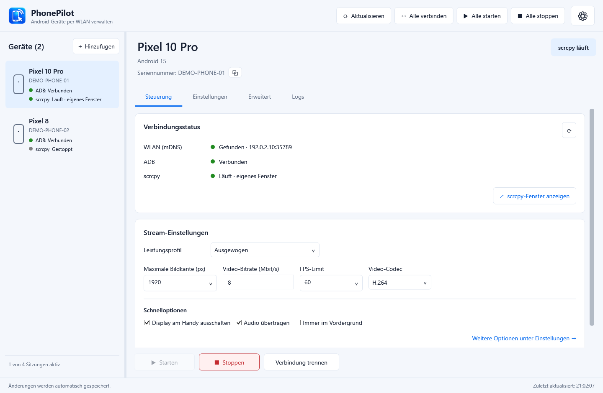
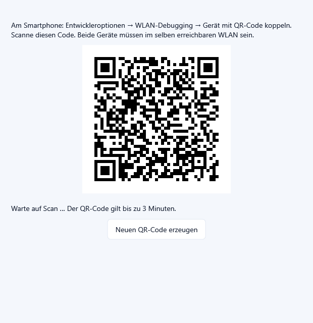
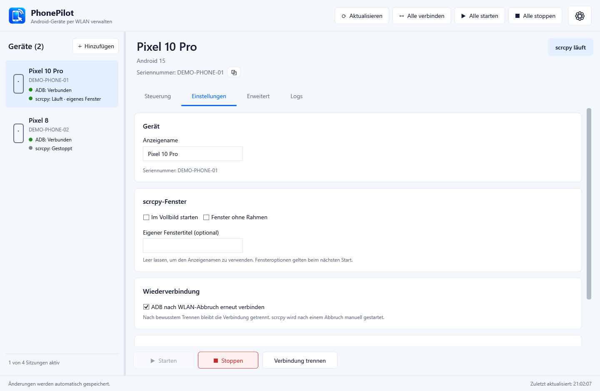
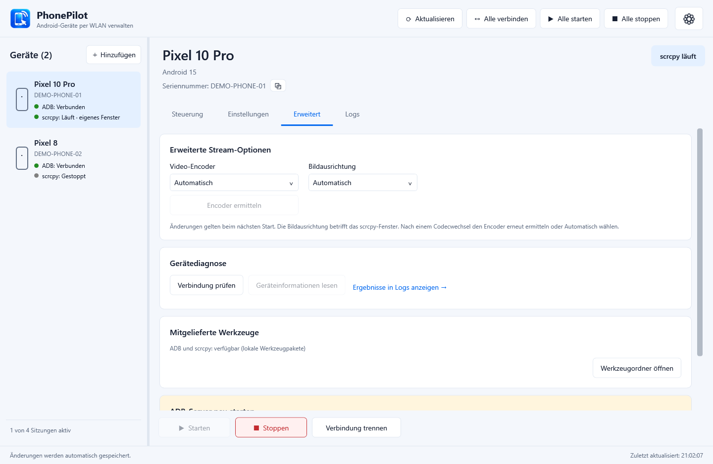
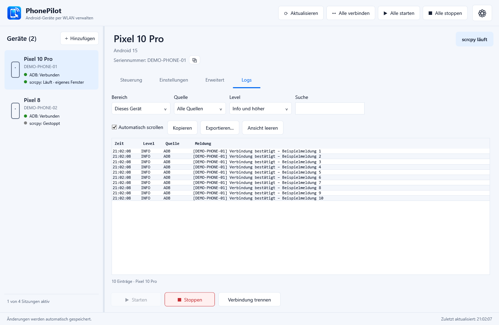
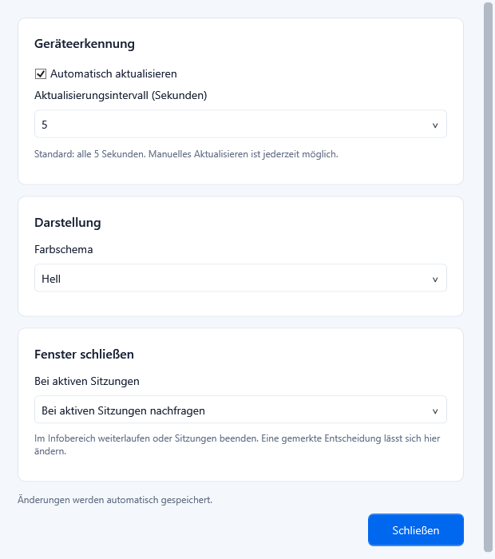
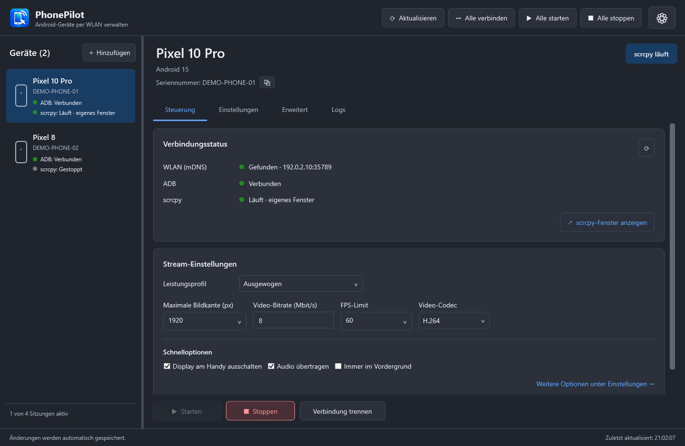
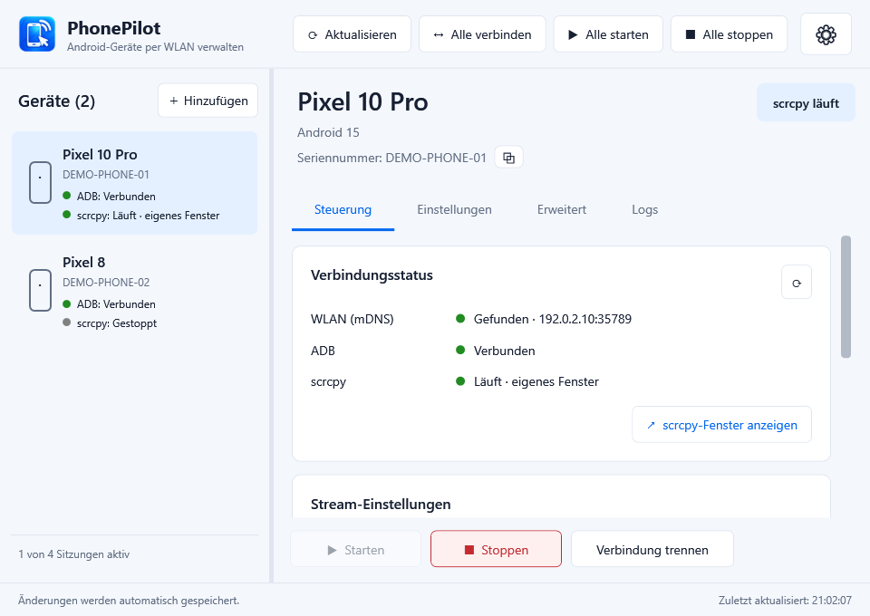

# PhonePilot

**Bis zu vier Android-Geräte gleichzeitig fernsteuern – mit der Leistung von scrcpy und einer komfortablen Windows-GUI.**

PhonePilot ist ein **grafisches Frontend für [scrcpy](https://github.com/Genymobile/scrcpy)**, ausgelegt auf die komfortable und performante Fernsteuerung von **bis zu vier Android-Geräten gleichzeitig über WLAN**. Die App bündelt Kopplung, Verbindungen und individuelle Stream-Einstellungen in einer übersichtlichen Oberfläche. Geräte lassen sich einzeln oder gemeinsam starten und stoppen, ohne dafür Kommandozeilenbefehle eingeben zu müssen.

**scrcpy** (ausgesprochen „screen copy“) ist ein kostenloses Open-Source-Werkzeug von Genymobile. Es überträgt Bild und Ton eines Android-Geräts auf den Computer und ermöglicht die Bedienung mit Maus und Tastatur – über USB oder Netzwerk und ohne Root-Zugriff. PhonePilot nutzt diese Grundlage für den WLAN-Betrieb: Jedes Gerät erhält ein eigenes Fenster, während Verbindungen und Einstellungen zentral über die GUI verwaltet werden.



*Stand: 10.10.2026. Die Screenshots zeigen die echte Oberfläche mit erfundenen Demo-Kennungen und simulierten Sitzungen.*

## Das bietet PhonePilot

- Android-Geräte automatisch im Netzwerk finden und per **QR-Code oder Kopplungscode** einrichten.
- Einzelne oder mehrere Geräte verbinden, starten und stoppen.
- Bildqualität, Auflösung, Bildrate, Audio und Fensterdarstellung je Gerät einstellen.
- ADB-Verbindungen nach WLAN-Abbrüchen automatisch wiederherstellen.
- Im Infobereich weiterlaufen und bestehende scrcpy-Fenster wieder aufrufen.
- Geräteinformationen und Verbindungsprobleme prüfen sowie Logs filtern und exportieren.
- Einstellungen automatisch speichern; helle und dunkle Darstellung wählen.


## Voraussetzungen und Start

### Download

**[PhonePilot für Windows herunterladen](https://github.com/MaxBatt/PhonePilot/releases/latest/download/PhonePilot-win-x64.zip)** · [Alle Versionen und Änderungen](https://github.com/MaxBatt/PhonePilot/releases)

1. **`PhonePilot-win-x64.zip`** aus dem neuesten Release herunterladen.
2. Das ZIP vollständig in einen beschreibbaren Ordner entpacken.
3. **`PhonePilot.exe`** starten und ein Smartphone koppeln. Eine Installation oder ein separat installiertes .NET ist nicht nötig; ADB und scrcpy sind enthalten.

**Aktualisieren:** PhonePilot einschließlich des Symbols im Infobereich vollständig beenden, das neue ZIP in den bisherigen Ordner entpacken und Programmdateien ersetzen. Die persönliche `config.json` und vorhandene Sicherungen behalten; diese Dateien sind nicht im Download enthalten. Zu jedem ZIP gibt es eine Datei mit der SHA-256-Prüfsumme.

Benötigt werden **Windows 11 x64**, ein Smartphone mit **Android 11 oder neuer** und aktiviertem **WLAN-Debugging** sowie ein gegenseitig erreichbares gemeinsames Netzwerk. Der PC kann auch per LAN am selben Router angeschlossen sein. Hinweise zum Smartphone enthält die [Android-Dokumentation](https://developer.android.com/tools/adb#connect-to-a-device-over-wi-fi).

**ADB und scrcpy sind im Projekt enthalten und werden beim Bauen automatisch mitgeliefert.** Ein separater Download oder eine systemweite Installation dieser Werkzeuge ist für den normalen Start nicht nötig.

Zum Benutzen den vollständigen portablen Programmausgabeordner entpacken und **`PhonePilot.exe`** starten. Im lokalen Projekt liegt dieser unter **`publish/`**. Die .NET-Laufzeit ist im fertigen Programmpaket enthalten. Alle Dateien und Unterordner zusammen behalten:

```text
PhonePilot.exe
THIRD-PARTY-NOTICES.txt
config.json              # persönliche Einstellungen, automatisch erzeugt
adb/                     # benötigte ADB-Dateien samt Originalhinweisen
scrcpy/                  # vollständiges scrcpy-Windows-Paket
```

Der Ordner muss zum Speichern beschreibbar sein. Fehlende Werkzeugdateien meldet die App. Beim Start werden Geräte gesucht; die Bildschirmübertragung beginnt erst durch **Starten**.

**Ein GitHub-Download über „Code → Download ZIP“ enthält den Quellcode samt Werkzeugen, aber keine fertig gebaute PhonePilot.exe.** Für diesen Weg den Abschnitt [Entwicklung](#entwicklung-und-weitere-dokumentation) verwenden. Zum Start ohne eigenen Build wird das vollständige portable Programmpaket benötigt.

## Gerät koppeln und verbinden

Am Smartphone die Entwickleroptionen und darin **WLAN-Debugging** aktivieren. Anschließend in PhonePilot **＋ Hinzufügen** wählen.

### Per QR-Code

1. In PhonePilot **Mit QR-Code koppeln** öffnen.
2. Am Smartphone **WLAN-Debugging → Gerät mit QR-Code koppeln** auswählen.
3. Den aktuellen Code in PhonePilot mit diesem Scanner erfassen.
4. Nach der Erfolgsmeldung den Dialog schließen, das Gerät auswählen und **Starten** wählen.



*Das Bild zeigt das QR-Panel. Der abgebildete Beispielcode gehört zu keiner aktiven Kopplung.*

Ein Versuch läuft höchstens **drei Minuten**. **Neuen QR-Code erzeugen** beginnt einen neuen Versuch; Tabwechsel oder Schließen bricht ihn ab. Die automatische Erkennung benötigt mDNS im Netzwerk.

### Per sechsstelliger Nummer

Am Smartphone **Gerät mit Kopplungscode koppeln** und in PhonePilot **Mit Code koppeln** öffnen. Die angezeigte **IPv4-Adresse**, den **Kopplungsport** und den **sechsstelligen Code** eingeben und **Koppeln** wählen. Danach das Gerät verbinden oder starten.

### Manuell verbinden

Wird ein bereits gekoppeltes Gerät nicht automatisch gefunden, unter **Manuell verbinden** seine aktuelle **`IPv4:Port`**-Adresse eingeben.

**Dafür den Verbindungsport auf der WLAN-Debugging-Hauptseite verwenden – der Kopplungsport ist ein anderer Port.** Nach einem Netzwerkwechsel kann sich die Adresse ändern. Manuelle Adressen werden nicht dauerhaft gespeichert.

Die Kopplung gehört zur ADB-Identität auf dem PC. Auf einem anderen PC kann eine erneute Kopplung nötig sein. Kopplungscodes und QR-Geheimnisse werden weder in PhonePilots Einstellungen noch in seinen Logs gespeichert.

## Geräte bedienen

Links ein Gerät auswählen; rechts erscheinen seine Informationen und vier Tabs. Seriennummern lassen sich kopieren, die Breite der Geräteliste lässt sich anpassen.

Die Statusanzeigen unterscheiden:

| Anzeige | Bedeutung |
| --- | --- |
| WLAN (mDNS) | Gerätedienst im Netzwerk gefunden |
| ADB | Verbindung zum Gerät, etwa Verbunden, Getrennt oder Nicht autorisiert |
| scrcpy | Zustand der eigenen Bildschirmübertragung |

Ein Gerät kann also verbunden sein, obwohl kein scrcpy-Fenster läuft.

Ein Doppelklick auf einen Geräteeintrag startet seine scrcpy-Sitzung. Per Rechtsklick stehen **Starten**, **Beenden** und **Gerät vergessen** zur Verfügung. Das Menü bezieht sich auf das angeklickte Gerät; beim Vergessen erscheint dieselbe Bestätigung wie beim vorhandenen Button. **Fenster anzeigen** erscheint nur, wenn das eigene scrcpy-Fenster existiert, auch wenn es minimiert ist.

Während einer laufenden Sitzung bietet das Menü außerdem **Handy-Display einschalten** beziehungsweise **Handy-Display ausschalten**. Die Spiegelung läuft weiter. Der tatsächliche Displayzustand wird beim Öffnen und während das Menü geöffnet ist abgefragt; nach dem Schalten wird das Ergebnis geprüft. Kann das Gerät seinen physischen Displayzustand nicht eindeutig melden, bleibt die Aktion mit **Displaystatus nicht verfügbar** ausgegraut. Die gespeicherte Startoption wird durch diese Aktion nicht geändert.

### Die wichtigsten Aktionen

| Aktion | Wirkung |
| --- | --- |
| **Aktualisieren** | Sucht Geräte und aktualisiert Zustände. |
| **Verbinden** | Stellt die ADB-Verbindung zum ausgewählten Gerät her. |
| **Starten** | Verbindet bei Bedarf und öffnet das scrcpy-Fenster. |
| **Stoppen** | Beendet die eigene Sitzung; ADB bleibt verbunden. |
| **Verbindung trennen** | Beendet die Sitzung, trennt ADB und setzt eigene Wiederverbindung aus. |
| **scrcpy-Fenster anzeigen** | Holt ein laufendes eigenes Fenster zurück. |
| **Alle verbinden / starten / stoppen** | Führt die Aktion für passende Geräte aus; ein Fehler blockiert die übrigen Geräte nicht. |

Das Limit von vier betrifft gleichzeitig laufende oder startende eigene Sitzungen. PhonePilot übernimmt oder beendet keine anderweitig gestarteten scrcpy-Prozesse.

### Steuerung

Hier stehen Verbindungsstatus, Leistungsprofil und Stream-Einstellungen. Schnelloptionen schalten **Audio**, **Display am Handy ausschalten** und **Immer im Vordergrund**.

| Profil | Maximale Bildkante | Bitrate | FPS-Limit | Codec |
| --- | ---: | ---: | ---: | --- |
| Qualität | 2560 px | 20 Mbit/s | 60 | H.265 |
| **Ausgewogen (Standard)** | 1920 px | 8 Mbit/s | 60 | H.264 |
| Schnell | 1280 px | 4 Mbit/s | 30 | H.264 |
| Benutzerdefiniert | Individuell | Individuell | Individuell | H.264/H.265 |

**Maximale Bildkante** begrenzt die längere Seite; das Seitenverhältnis bleibt erhalten. **Original** lässt diese Grenze weg. **Unbegrenzt** beim FPS-Limit übergibt keine Bildratenbegrenzung. Manuelle Änderungen an diesen Werten, Bitrate oder Codec wechseln zum benutzerdefinierten Profil.

**Stream- und Fensteränderungen gelten beim nächsten Start.** Eine laufende Sitzung behält ihre bisherigen Einstellungen. Tatsächliche Qualität und Geschwindigkeit hängen von Gerät, PC und Netzwerk ab.

### Einstellungen



Hier lassen sich **Anzeigename**, **Vollbild**, **rahmenloses Fenster**, **eigener Fenstertitel** und **ADB-Wiederverbindung** pro Gerät festlegen.

**Gerät vergessen** entfernt den gespeicherten Eintrag und seine Einstellungen und beendet eine eigene Sitzung. Die Android-Kopplung bleibt bestehen; das Gerät kann erneut gefunden werden. Zum vollständigen Entkoppeln den PC am Smartphone unter WLAN-Debugging entfernen.

### Erweitert



- **Encoder ermitteln** zeigt verfügbare Video-Encoder für den gewählten Codec. Nach einem Codecwechsel neu abfragen oder Automatisch wählen.
- **Bildausrichtung** wählt Automatisch oder eine feste Drehung.
- **Verbindung prüfen** und **Geräteinformationen lesen** helfen bei der Diagnose.
- **Werkzeugordner öffnen** zeigt den Ordner mit ADB und scrcpy.
- **ADB-Server neu starten** beendet eigene Sitzungen und startet nach Bestätigung den gemeinsamen Server neu. Das kann auch andere ADB-Anwendungen betreffen.

### Logs



Meldungen nach **Gerät**, **Quelle**, **Level** oder **Suchtext** filtern. **Kopieren** und **Exportieren** übernehmen die gefilterte Ansicht. **Ansicht leeren** blendet bisherige Meldungen aus, löscht aber keine Protokolldateien.

Logdateien liegen unter **`%TEMP%\PhonePilot\Logs`**. Vor dem öffentlichen Teilen von Logs oder eigenen Screenshots **Seriennummern, Gerätenamen und Netzwerkadressen prüfen und gegebenenfalls anonymisieren**.

## Allgemeine Einstellungen und Hintergrundbetrieb

Das **Zahnrad oben rechts** öffnet die appweiten Einstellungen:

| Einstellung | Auswahl |
| --- | --- |
| Automatische Aktualisierung | Standardmäßig an, **alle 5 Sekunden**; wählbar sind 2, 5, 10, 15, 30 oder 60 Sekunden |
| Farbschema | Windows-Einstellung, Hell oder Dunkel |
| Schließen bei aktiven Sitzungen | Nachfragen, im Infobereich weiterlaufen oder Sitzungen beenden und schließen |



**Aktualisieren** bleibt auch bei ausgeschalteter Automatik nutzbar. Die App verhindert überlappende Erkennungsrunden.

Bei aktiviertem Hintergrundbetrieb bleiben Sitzungen nach dem Schließen des Hauptfensters aktiv. Das Symbol im Infobereich bietet **Öffnen**, **Alle Sitzungen stoppen** und **Beenden**. Ein erneuter Start der EXE öffnet die bestehende Instanz. Ohne aktive Sitzungen oder laufende Geräteaktionen beendet das Schließen die App regulär.

Nach einem WLAN-Abbruch kann PhonePilot ADB automatisch wiederverbinden, wenn die Geräteoption und automatische Aktualisierung aktiv sind und das Gerät wieder gefunden wird. **scrcpy wird anschließend manuell gestartet.** Nach bewusstem Trennen muss ausdrücklich **Verbinden** oder **Starten** gewählt werden.

### Dunkelmodus und kompakte Ansicht





## Einstellungen sichern

PhonePilot speichert Geräte- und App-Einstellungen automatisch in **`config.json` neben der EXE**. Aktuelle IP-Adressen, Ports, Sitzungszustände und Kopplungsgeheimnisse werden darin nicht gespeichert.

Alte PixelRemote-Konfigurationen werden mit Sicherung übernommen. Beschädigte oder unbekannte Formate werden vor Überschreiben geschützt; die angebotene Wiederherstellung sichert zuerst das Original. Beim Aktualisieren der App **`config.json` und vorhandene `config.json.*.bak` behalten**.

## Häufige Probleme

| Problem | Vorgehen |
| --- | --- |
| Gerät fehlt oder QR-Kopplung wartet | WLAN-Debugging und gegenseitige Erreichbarkeit prüfen. Gastnetz, VPN oder Firewall können mDNS behindern. Alternativ mit Code koppeln und manuell verbinden. |
| Kopplung schlägt fehl | Frischen QR-Code beziehungsweise aktuellen Nummerncode und zugehörigen Kopplungsport verwenden. |
| Gekoppelt, aber nicht verbunden | **Verbinden** oder **Starten** wählen; manuell den aktuellen Verbindungsport verwenden. |
| scrcpy startet nicht | Logs prüfen, H.264 und Schnell/Ausgewogen versuchen; Encoder auf Automatisch setzen. |
| Kein Audio | Audiooption prüfen; unter Android 11 das Telefon vor dem Start entsperren. Siehe [scrcpy-Audiohinweise](https://github.com/Genymobile/scrcpy/blob/master/doc/audio.md). |
| Änderungen wirken noch nicht | Sitzung stoppen und neu starten. |
| Keine weitere Sitzung möglich | Eine der vier eigenen Sitzungen stoppen. |
| Einstellungen werden nicht gespeichert | Schreibrechte des App-Ordners und angezeigte Konfigurationshinweise prüfen. |
| App läuft nach dem Schließen weiter | Über das Symbol im Infobereich vollständig beenden. |

## Entwicklung und weitere Dokumentation

PhonePilot ist eine **C#-/WPF-Anwendung mit .NET 10**. ADB übernimmt Erkennung und Verbindung, [scrcpy](https://github.com/Genymobile/scrcpy) die Fernsteuerung. Die Oberfläche liegt unter `Desktop/`, der Anwendungskern unter `src/PhonePilot.Core/` und die Tests unter `tests/`.

Das Repository enthält bereits **ADB 37.0.1** unter `adb/` und **scrcpy 4.1** unter `scrcpy/`. Nach dem Klonen oder Entpacken des Quellcodes wird zum Bauen nur noch das .NET 10 SDK unter Windows benötigt; beim ersten Build werden die NuGet-Abhängigkeiten heruntergeladen:

```powershell
dotnet build .\PhonePilot.csproj
dotnet test .\tests\PhonePilot.Tests\PhonePilot.Tests.csproj
.\build.ps1 -NoLaunch
```

Das Build-Skript erstellt `publish/` und erhält dort Konfiguration und Sicherungen. Vor dem Ersetzen der EXE PhonePilot vollständig schließen. Prüfstand vom 10.10.2026: **49 automatisierte Tests bestanden**, QR-Kopplung praktisch bestätigt.

Ein sauberes Download-Paket erstellt `powershell -ExecutionPolicy Bypass -File .\tools\New-ReleaseZip.ps1`. ZIP und SHA-256-Prüfsumme liegen anschließend in einem eigenen Unterordner unter `artifacts/releases/`. Persönliche Einstellungen werden nicht übernommen; der bestehende `publish/`-Ordner bleibt unberührt.

**Werkzeuge bei Bedarf ersetzen:** PhonePilot und eigene scrcpy-Sitzungen beenden. Die offiziellen [Android Platform-Tools für Windows](https://developer.android.com/tools/releases/platform-tools) herunterladen und den Inhalt des entpackten `platform-tools`-Ordners direkt nach `adb/` übernehmen. Das vollständige [scrcpy-Windows-x64-Paket](https://github.com/Genymobile/scrcpy/releases) direkt nach `scrcpy/` entpacken. Danach müssen `adb/adb.exe` und `scrcpy/scrcpy.exe` ohne zusätzliche Zwischenordner vorhanden sein. DLLs, `scrcpy-server` und Lizenzhinweise mit übernehmen und PhonePilot neu bauen. Andere Versionen anschließend auf Kompatibilität prüfen.

- [Spezifikation](docs/PhonePilot-Spezifikation.md)
- [Implementierung und Prüfstand](docs/Implementierung-und-Pruefung.md)
- [Alle Screenshots und ihre Herkunft](docs/screenshots/2026-10-10/README.md)
- [Anwendungssymbol](Assets/README.md) und [Drittanbieterhinweise](THIRD-PARTY-NOTICES.txt)
